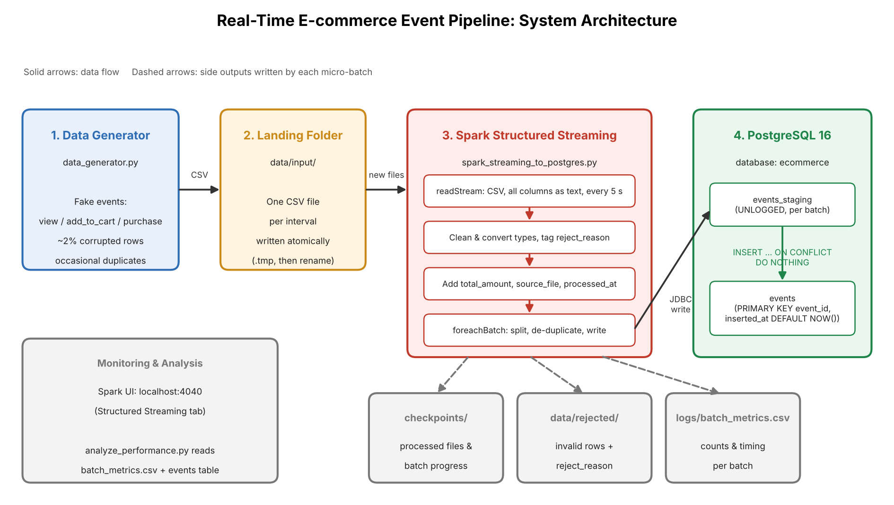

# Real-Time E-commerce Event Pipeline

A real-time data pipeline that simulates e-commerce user activity, processes it with Apache Spark Structured Streaming, and stores it in PostgreSQL.

A generator writes CSV files of fake events (views, add-to-cart actions and purchases) into a folder. Spark detects each new file, cleans and validates the events, and writes them to PostgreSQL in micro-batches, using idempotent writes so that replayed batches never create duplicates.



## Highlights

- Continuous ingestion with Spark Structured Streaming and checkpoint-based recovery
- Validation that labels every invalid row with a reason and keeps it for inspection
- Idempotent writes through a staging table and `INSERT ... ON CONFLICT DO NOTHING`
- Per-event latency measurement built into the table design
- Tested from 20 to about 6,700 events per second, with mean end-to-end latency of 4.5–7 seconds and every input row accounted for

## Project Structure

```
ecommerce-streaming-pipeline/
├── data_generator.py                 # generates fake event CSV files
├── spark_streaming_to_postgres.py    # Spark streaming job
├── postgres_setup.sql                # creates the user, database and tables
├── postgres_connection_details.txt   # host, port, user, password
├── analyze_performance.py            # summarizes performance for a test run
├── scripts/
│   └── reset_pipeline.ps1            # resets the pipeline to a clean state
├── docs/
│   ├── project_overview.md           # components and data flow
│   ├── user_guide.md                 # setup and run instructions
│   ├── test_cases.md                 # manual test plan and results
│   ├── performance_metrics.md        # latency and throughput report
│   └── system_architecture.png       # architecture diagram
├── data/input/                       # landing folder (contents git-ignored)
├── requirements.txt
└── .env.example
```

## Quick Start

Requires Python 3.11, Java 17, PostgreSQL 16 and, on Windows, the Hadoop binaries (`winutils.exe`, `hadoop.dll`). See the [User Guide](docs/user_guide.md) for full details.

```powershell
py -3.11 -m venv .venv
.venv\Scripts\Activate.ps1
pip install -r requirements.txt

psql -U postgres -f postgres_setup.sql
Copy-Item .env.example .env          # then set PG_PASSWORD=ecommerce_local_pw
```

Run in two terminals:

```powershell
# Terminal 1: wait for "Streaming started"
python spark_streaming_to_postgres.py

# Terminal 2
python data_generator.py
```

Check the results:

```powershell
$env:PGPASSWORD = "ecommerce_local_pw"
psql -h localhost -U ecommerce_user -d ecommerce -c "SELECT event_type, COUNT(*) FROM events GROUP BY event_type;"
```

## Documentation

| Document | Contents |
|---|---|
| [Project Overview](docs/project_overview.md) | System components, data flow and reliability features |
| [User Guide](docs/user_guide.md) | Setup, running, options, resetting and troubleshooting |
| [Test Cases](docs/test_cases.md) | Manual test plan with expected and actual results |
| [Performance Metrics](docs/performance_metrics.md) | Throughput and latency under three load levels |

## Tech Stack

Apache Spark 3.5.1 (PySpark) · PostgreSQL 16 · Python 3.11 · psycopg2 · PostgreSQL JDBC driver
