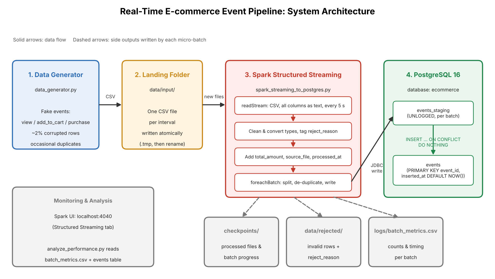

# Project Overview

## Purpose

This project is a real-time data pipeline that simulates an e-commerce platform tracking user activity. Fake user events (product views, add-to-cart actions and purchases) are generated continuously as CSV files, processed as they arrive with Apache Spark Structured Streaming, and stored in a PostgreSQL database.



## Components

### 1. Data Generator (`data_generator.py`)

Simulates website traffic by writing a CSV file of events into `data/input/` at a fixed interval. Each event contains an ID, event type, user, product details, quantity and timestamp. Products come from a fixed catalog, so each product ID always has the same name, category and price.

Event types follow a realistic funnel: 70% views, 20% add-to-cart and 10% purchases. To exercise the pipeline's data quality handling, the generator deliberately corrupts a small share of rows (2% by default) with problems such as missing prices, negative quantities, invalid event types and unparseable timestamps, and occasionally duplicates a row.

Each file is written to a hidden temporary file first and then renamed. Because a rename is instant, Spark never sees a partially written file.

### 2. Landing Folder (`data/input/`)

The folder acts as the hand-off point between the generator and Spark. In a production system, this role would typically be played by cloud storage or a message queue such as Kafka.

### 3. Spark Streaming Job (`spark_streaming_to_postgres.py`)

Monitors the landing folder and processes new files in micro-batches every 5 seconds. For each batch, it:

1. **Reads** the new CSV files with a fixed schema in which every column is text. This keeps full control over type conversion, so the reason for every bad value can be identified.
2. **Cleans** the data: trims whitespace, normalizes event types to lowercase (so `"  VIEW "` becomes `"view"`), and converts columns to their proper types.
3. **Validates** each row and tags invalid ones with a `reject_reason`, such as `invalid_price` or `invalid_timestamp`.
4. **Enriches** valid rows with `total_amount` (price × quantity for purchases, 0 otherwise), `source_file` and `processed_at`.
5. **Writes** the results inside `foreachBatch`: rejected rows go to `data/rejected/` for inspection, duplicates are removed, and valid rows are written to PostgreSQL.
6. **Records** row counts and processing time for the batch in `logs/batch_metrics.csv`.

### 4. PostgreSQL (`postgres_setup.sql`)

The `ecommerce` database contains two tables:

- **`events`** is the final table. It enforces data quality with a primary key on `event_id`, `NOT NULL` columns and `CHECK` constraints on event type, price and quantity. Its `inserted_at` column records when each row was stored.
- **`events_staging`** is an unlogged scratch table that receives each micro-batch before it is copied into `events`.

The database is owned by a dedicated user, `ecommerce_user`, which has access only to this database. This follows the principle of least privilege and is why the connection details can be shared in `postgres_connection_details.txt`.

## Data Flow

```
Generator → data/input/*.csv → Spark readStream → clean & validate → foreachBatch
    → rejected rows: data/rejected/
    → valid rows: de-duplicate → events_staging (JDBC) → events (INSERT ... ON CONFLICT DO NOTHING)
    → metrics: logs/batch_metrics.csv
```

## Reliability Features

- **Atomic file writes** prevent Spark from reading partially written files.
- **Checkpointing** (`checkpoints/`) records which files have been processed, so a restarted job resumes where it left off instead of reprocessing old data.
- **Idempotent writes.** Spark guarantees each batch is processed at least once, so after a crash, a batch may be replayed. Writing each batch to a staging table and then copying it into `events` with `ON CONFLICT DO NOTHING` means a replayed batch skips rows that are already stored, instead of failing on the primary key or creating duplicates.
- **Dead-letter output.** Invalid rows are kept in `data/rejected/` with the reason for rejection, rather than silently discarded.
- **Fail-fast startup.** The job checks the database connection before starting Spark, giving a clear error message if PostgreSQL is unreachable.
- **Database constraints** act as a final safeguard if invalid data ever got past Spark's validation.

## Monitoring and Performance

Every micro-batch logs its input, inserted, rejected and duplicate row counts along with processing time. The Spark UI at `http://localhost:4040` shows live input and processing rates. `analyze_performance.py` combines the batch metrics with per-event latency measured in PostgreSQL.

Across three load levels, from 20 to about 6,700 events per second, the pipeline kept up with incoming data, held mean end-to-end latency between 4.5 and 7 seconds, and accounted for every input row. Full results are in `performance_metrics.md`.

## Technology Stack

| Component | Technology |
|---|---|
| Stream processing | Apache Spark 3.5.1 (PySpark), Structured Streaming |
| Database | PostgreSQL 16 |
| Spark–database connection | PostgreSQL JDBC driver 42.7.3 |
| Language | Python 3.11 |
| Database access from Python | psycopg2 |
